# ha-wero-card

[](https://www.home-assistant.io/integrations/marketplace/)
[](https://github.com/juju35/ha-wero-card/actions/workflows/hacs.yml)
[](https://github.com/juju35/ha-wero-card/actions/workflows/validate.yml)
[](https://github.com/juju35/ha-wero-card/actions/workflows/lint.yml)
[](https://github.com/juju35/ha-wero-card/releases/latest)
[](https://github.com/juju35/ha-wero-card/blob/main/LICENSE)
[](https://buymeacoffee.com/julienstep9)

<p align="center"></p>

Custom Lovelace card for Home Assistant that displays your [Wero](https://wero-wallet.eu) QR code, so guests can pay you back without asking for your phone number or IBAN.

**Zero external dependencies** — the QR code is generated in pure JavaScript with an embedded Reed-Solomon encoder. No CDN, no network requests.

[](https://my.home-assistant.io/redirect/marketplace_repository/?owner=juju35&repository=ha-wero-card&category=plugin)

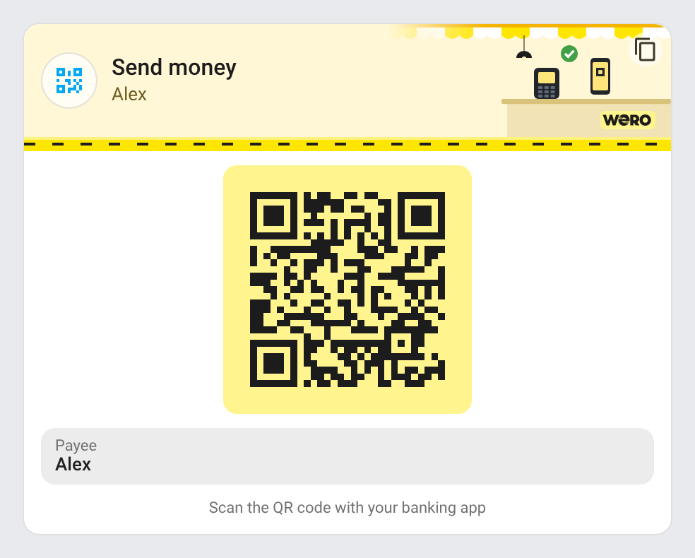

## Features

- QR code generated in pure JS (embedded Reed-Solomon algorithm), with a spec-compliant quiet zone
- Illustrated header: a shop counter with its payment terminal, a phone that taps it and the Wero logo on the counter, over a Wero-yellow strip; day and night pictures (night after sunset or with the dark theme), animated (respects reduced motion), `illustration: false` for the classic header
- Status pill on the title row (Ready, Waiting, Received or Unavailable, in the colour of the QR icon); optional payment status `entity` (green tick, the QR icon and the pill turn green once paid)
- Wero logo in the header (can be disabled)
- Two cards: `wero-card` and its mini version `wero-mini-card` (the illustrated header alone, with the scannable QR code standing on the counter; a tap on it opens the QR code full screen, a detail button shows the full card)
- Copy-link button to share the payment link by message (the result is also announced to screen readers)
- Tap the QR code to show it fullscreen (tap again or press Escape to close)
- Visual editor: add and configure the card from the dashboard UI, no YAML needed
- Fully compatible with Home Assistant dark mode and sections dashboards (6 columns by default and at least, so the title stays readable)
- Keyboard friendly: visible focus on the copy button and the QR code, Enter or Space opens the QR code fullscreen
- English, French, German, Spanish, Serbian (Cyrillic and Latin), Italian, Dutch, European Portuguese, Polish, Romanian, Danish, Swedish, Bulgarian, Russian, Ukrainian, Hungarian, Slovak, Czech, Slovenian, Latvian and Greek, auto-detected
- Ready for the Marketplace, single file (~55 KB)

## Prerequisites

Home Assistant 2024.8 or later, and:

A Wero payment link, generated by your bank:

### Getting your Wero link

There is no public format to build a Wero QR code from a phone number or an IBAN: the card re-encodes the link that your bank generates.

1. In your banking app (or the Wero app), open Wero and generate your QR code / payment link.
2. Either use the app's share option to copy the link, or scan the QR code with a generic QR reader (not a banking app) and copy the URL.
3. The link looks like `https://share.weropay.eu/p/1/c/XXXXXXXXXX`.

> Check that the link is still valid after a few days before printing it or relying on it: its lifetime depends on how your bank generated it.

## Supported integrations

The card needs no integration. The optional payment status `entity` can come from any of these:

- [Input boolean](https://www.home-assistant.io/integrations/input_boolean/) — a helper switched on by you or an automation (e.g. on your bank's notification)
- [Template](https://www.home-assistant.io/integrations/template/) — a `binary_sensor` built from your own sensors
- [Sun](https://www.home-assistant.io/integrations/sun/) — `sun.sun` switches the illustration to night (`illustration_theme: auto`)

## Installation

### Via the Marketplace (recommended)

Click the button below to add the repository directly:

[](https://my.home-assistant.io/redirect/marketplace_repository/?owner=juju35&repository=ha-wero-card&category=plugin)

Then click **Install**, and reload your browser when the Marketplace asks you to.

Or manually:

1. Open **Settings → Marketplace → Add from link** (top right; this needs a GitHub account connected)
2. Add `https://github.com/juju35/ha-wero-card` — Type: **Dashboard**
3. Open **Wero QR Card** and click **Install**
4. Clear your browser cache and refresh

### Manual

1. Download `wero-card.js` and the `wero-card.i18n.*.js` translation files from the [latest release](https://github.com/juju35/ha-wero-card/releases/latest)
2. Copy them all to `/config/www/` (without the translation files, the cards show in English)
3. Go to **Settings → Dashboards → Resources** → Add resource:
   - URL: `/local/wero-card.js`
   - Type: **JavaScript Module**
4. Clear your browser cache and refresh

## Configuration

### Visual editor

Edit your dashboard → **Add card** → search for **Wero QR Card** (or **Wero QR mini card**). Every option below can be set from the form; switch to the code editor if you prefer YAML.

### Minimal

```yaml
type: custom:wero-card
url: https://share.weropay.eu/p/1/c/XXXXXXXXXX
```

### Full options

```yaml
type: custom:wero-card
url: https://share.weropay.eu/p/1/c/XXXXXXXXXX
title: Refund
name: Alex
entity: input_boolean.wero_paid
logo: true
illustration: true
illustration_theme: auto
qr_size: 176
language: en
```

### Mini card

```yaml
type: custom:wero-mini-card
url: https://share.weropay.eu/p/1/c/XXXXXXXXXX
name: Alex
zoom: true
```

The mini card takes the same options as the full card, plus `zoom`. With the illustrated header (default), it is the 90 px header alone: the QR code itself stands on the shop counter at the right, framed in white around its quiet zone (day and night), under the copy and detail buttons of the top right corner; a tap on it opens it full screen. With `illustration: false`, it shows the logo, the title and the payee name on one row, with a small QR thumbnail on the right. A tap on the thumbnail opens the QR code full screen, like the big one of the full card. The detail button (top right) switches to the full card; the button, or a click anywhere outside the card, brings the compact view back. The copy button sits at the left of the detail button, on its line; on a card 200 px wide or less the thumbnail gets smaller and the copy button gives way (the full card keeps it).

### Options reference

| Option | Required | Default | Description |
|---|---|---|---|
| `url` | ✅ | — | The `https://` link encoded in your Wero QR code |
| `title` | ❌ | Auto (i18n) | Card title |
| `show_title` | ❌ | `true` | Show the title in the header (e.g. `false` under a section heading of your own) |
| `name` | ❌ | — | Payee name, shown under the QR code |
| `entity` | ❌ | — | Payment status entity (e.g. an `input_boolean` or a `binary_sensor` set by an automation). `on`, `true`, `received`, `paid`, `completed`, `done` or `success` mean « Received », any other state « Waiting », `unavailable` / `unknown` greys the icon and the pill (« Unavailable »). Without it the pill shows « Ready » |
| `logo` | ❌ | `true` | Show the Wero logo (on the illustration's counter; in the classic header, `false` shows a generic icon) |
| `illustration` | ❌ | `true` | Illustrated 90 px header (shop counter, payment terminal); `false` keeps the classic header |
| `illustration_theme` | ❌ | `auto` | `auto` (night when `sun.sun` is below the horizon or the theme is dark), `day` or `night` |
| `qr_size` | ❌ | `176` | QR code size in pixels (quiet zone included); shrinks to fit a narrower card |
| `zoom` | ❌ | `true` | Mini card only: detail button at the top right that switches to the full card and back (a click outside the card brings the compact view back) |
| `language` | ❌ | Auto | Force language: `en`, `fr`, `de`, `es`, `sr`, `sr-Latn`, `it`, `nl`, `pt`, `pl`, `ro`, `da`, `sv`, `bg`, `ru`, `uk`, `hu`, `sk`, `cs`, `sl`, `lv` or `el` (auto-detects from HA settings; « Automatic » in the visual editor) |

## Screenshots

| Light | Dark |
|---|---|
|  | 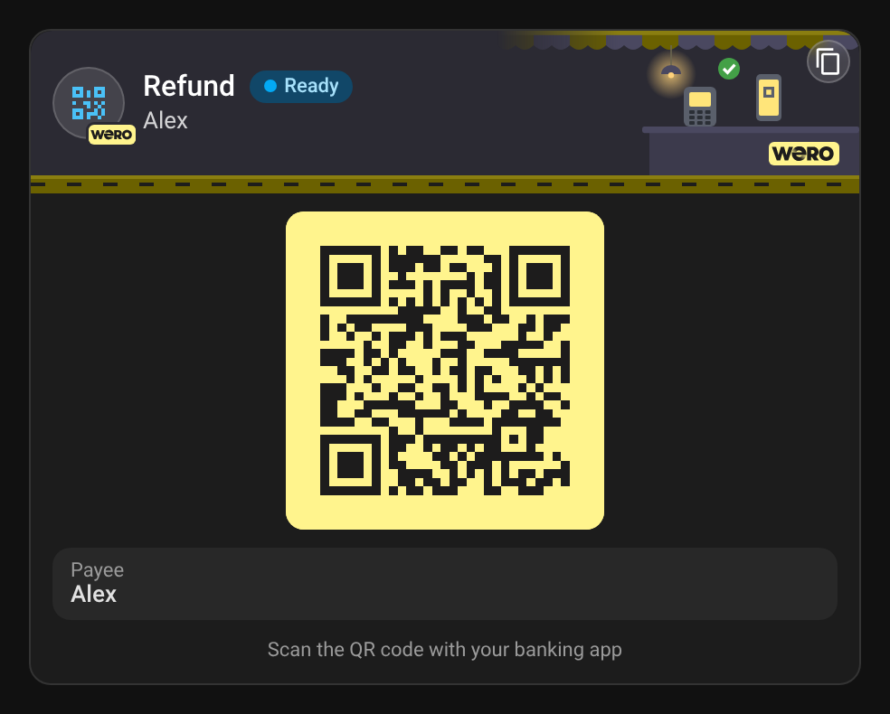 |
| 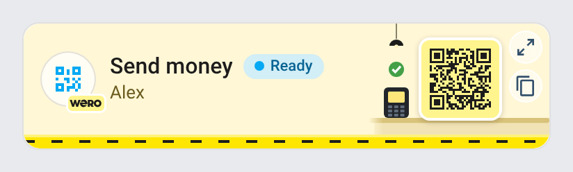 | 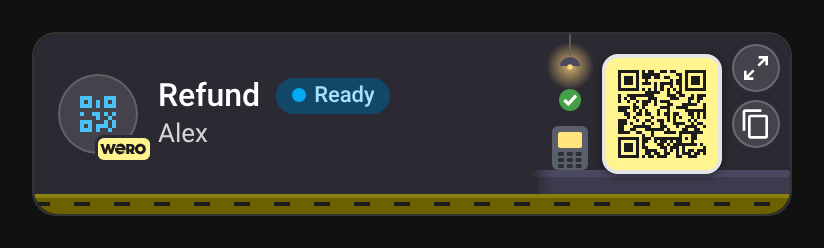 |
| 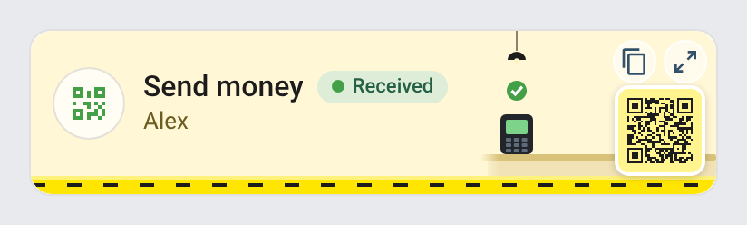 | 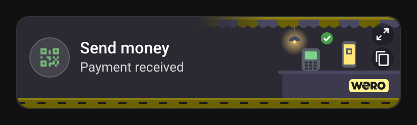 |
| 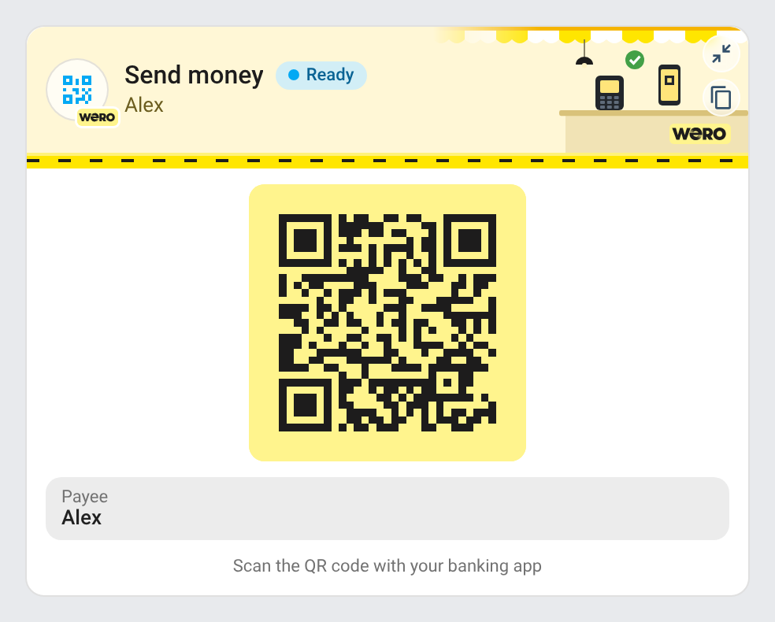 | 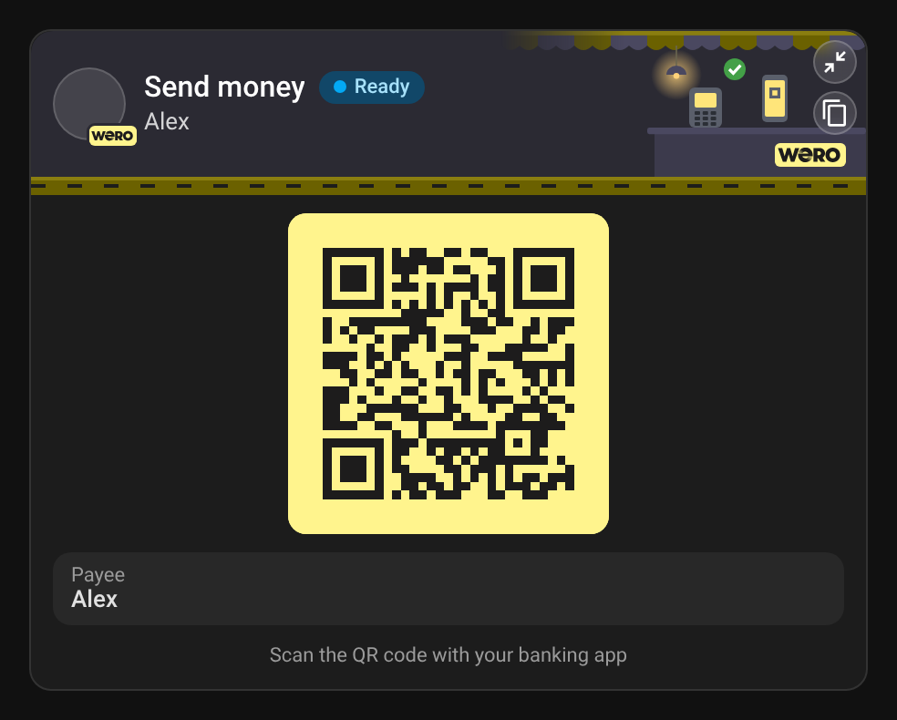 |
| 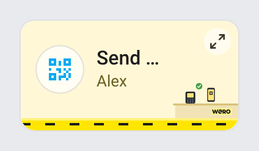 | 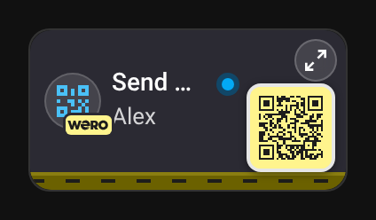 |

### Animations

The phone taps the payment terminal and the green tick comes up, in a loop; while a payment is expected (`entity`), the terminal's dots blink too. At night the lamp glows over the counter. With `prefers-reduced-motion`, everything stays still.

Ready (no payment entity):

| Light | Dark |
|---|---|
| 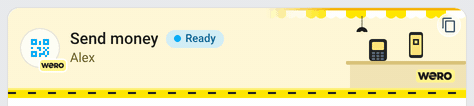 | 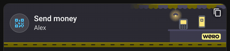 |

Waiting for the payment:

| Light | Dark |
|---|---|
| 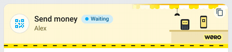 | 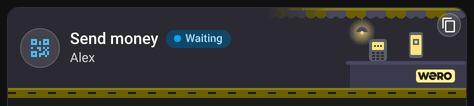 |

Mini card:

| Light | Dark |
|---|---|
| 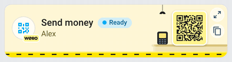 | 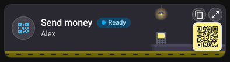 |

## How it works

The card encodes `url` as-is into a QR code (error correction level M). Scanning it with a Wero-enabled banking app, or with the phone camera, opens the Wero payment flow for the payee behind the link.

The logo is kept out of the QR code on purpose: overlaying a logo on the modules makes scanning unreliable.

## Development

```bash
npm install
npm run build        # stamps the version of package.json into dist/wero-card.js
npm run check        # builds and checks the card (run in CI)
npm run screenshots  # renders the stills (PNG) and the header animations (GIF, needs ffmpeg) into screenshots/ (a file is rewritten only when its pixels change)
```

`dist/` is not committed: `npm run build` creates it locally, CI builds it on every push, and the release workflow attaches the built file to the release, which is where the Marketplace installs it from.

### Releasing

1. Bump `version` in `package.json`
2. Add a `## <version>` section at the top of [CHANGELOG.md](https://github.com/juju35/ha-wero-card/blob/main/CHANGELOG.md)
3. Push to `main`: the **Release** workflow builds the card, creates the tag and the GitHub release with the changelog section as notes, and attaches `wero-card.js`

## Translations

The card auto-detects the language from your Home Assistant settings. Currently supported:

| Language | Code |
|---|---|
| English | `en` |
| Français | `fr` |
| Deutsch | `de` |
| Español | `es` |
| Српски | `sr` |
| Srpski (latinica) | `sr-Latn` |
| Italiano | `it` |
| Nederlands | `nl` |
| Português (Portugal) | `pt` |
| Polski | `pl` |
| Română | `ro` |
| Dansk | `da` |
| Svenska | `sv` |
| Български | `bg` |
| Русский | `ru` |
| Українська | `uk` |
| Magyar | `hu` |
| Slovenčina | `sk` |
| Čeština | `cs` |
| Slovenščina | `sl` |
| Latviešu | `lv` |
| Ελληνικά | `el` |

Regional variants fall back to their base language (`pt-BR` uses European Portuguese, `nl-BE` Dutch); untranslated languages fall back to English.

Contributions for additional languages are welcome!

## Disclaimer

This project is not affiliated with, endorsed by, or sponsored by EPI Company. Wero and the Wero logo are trademarks of EPI Company, used here only to identify the payment method.

## License

[MIT](https://github.com/juju35/ha-wero-card/blob/main/LICENSE)

## Support

If you find this project useful, you can support its development:

<a href="https://buymeacoffee.com/julienstep9"></a>
