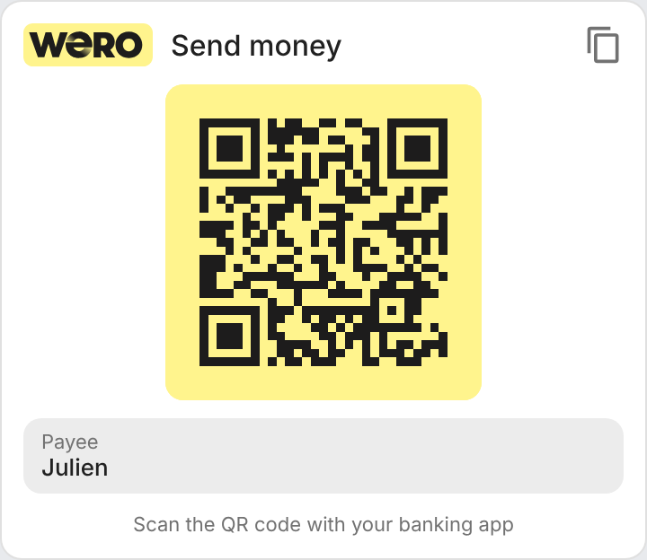

# ha-wero-card

[](https://github.com/hacs/integration)
[](https://github.com/juju35/ha-wero-card/actions/workflows/hacs.yml)
[](https://github.com/juju35/ha-wero-card/actions/workflows/validate.yml)
[](https://github.com/juju35/ha-wero-card/releases/latest)
[](LICENSE)

Custom Lovelace card for Home Assistant that displays your [Wero](https://wero-wallet.eu) QR code, so guests can pay you back without asking for your phone number or IBAN.

**Zero external dependencies** — the QR code is generated in pure JavaScript with an embedded Reed-Solomon encoder. No CDN, no network requests.

[](https://my.home-assistant.io/redirect/hacs_repository/?owner=juju35&repository=ha-wero-card&category=plugin)


## Features

- QR code generated in pure JS (embedded Reed-Solomon algorithm), with a spec-compliant quiet zone
- Wero logo in the header (can be disabled)
- Copy-link button to share the payment link by message
- Tap the QR code to show it fullscreen (tap again or press Escape to close)
- Visual editor: add and configure the card from the dashboard UI, no YAML needed
- Fully compatible with Home Assistant dark mode and sections dashboards
- French / English, auto-detected
- HACS-ready, single file (~25 KB)

## Prerequisites

Home Assistant 2024.8 or later, and:

A Wero payment link, generated by your bank:

### Getting your Wero link

There is no public format to build a Wero QR code from a phone number or an IBAN: the card re-encodes the link that your bank generates.

1. In your banking app (or the Wero app), open Wero and generate your QR code / payment link.
2. Either use the app's share option to copy the link, or scan the QR code with a generic QR reader (not a banking app) and copy the URL.
3. The link looks like `https://share.weropay.eu/p/1/c/XXXXXXXXXX`.

> Check that the link is still valid after a few days before printing it or relying on it: its lifetime depends on how your bank generated it.

## Installation

### Via HACS (recommended)

Click the button below to add the repository directly:

[](https://my.home-assistant.io/redirect/hacs_repository/?owner=juju35&repository=ha-wero-card&category=plugin)

Then click **Download**, and reload your browser when HACS asks you to.

Or manually:

1. Open HACS → **⋮** (top right) → **Custom repositories**
2. Add `https://github.com/juju35/ha-wero-card` — Type: **Dashboard**
3. Search for **Wero QR Card** and click **Download**
4. Clear your browser cache and refresh

### Manual

1. Download `wero-card.js` from the [latest release](https://github.com/juju35/ha-wero-card/releases/latest)
2. Copy it to `/config/www/wero-card.js`
3. Go to **Settings → Dashboards → Resources** → Add resource:
   - URL: `/local/wero-card.js`
   - Type: **JavaScript Module**
4. Clear your browser cache and refresh

## Configuration

### Visual editor

Edit your dashboard → **Add card** → search for **Wero QR Card**. Every option below can be set from the form; switch to the code editor if you prefer YAML.

### Minimal

```yaml
type: custom:wero-card
url: https://share.weropay.eu/p/1/c/XXXXXXXXXX
```

### Full options

```yaml
type: custom:wero-card
url: https://share.weropay.eu/p/1/c/XXXXXXXXXX
title: Remboursement
name: Alex
logo: true
qr_size: 176
language: fr
```

### Options reference

| Option | Required | Default | Description |
|---|---|---|---|
| `url` | ✅ | — | The `https://` link encoded in your Wero QR code |
| `title` | ❌ | Auto (i18n) | Card title |
| `name` | ❌ | — | Payee name, shown under the QR code |
| `logo` | ❌ | `true` | Show the Wero logo in the header (`false` shows a generic icon) |
| `qr_size` | ❌ | `176` | QR code size in pixels (quiet zone included); shrinks to fit a narrower card |
| `language` | ❌ | Auto | Force language: `fr` or `en` (auto-detects from HA settings) |

## Screenshots

| Light | Dark (French) |
|---|---|
|  |  |

## How it works

The card encodes `url` as-is into a QR code (error correction level M). Scanning it with a Wero-enabled banking app, or with the phone camera, opens the Wero payment flow for the payee behind the link.

The logo is kept out of the QR code on purpose: overlaying a logo on the modules makes scanning unreliable.

## Development

```bash
npm install
npm run build        # stamps the version of package.json into dist/wero-card.js
npm run check        # builds and checks the card (run in CI)
npm run screenshots  # renders the card into screenshots/
```

`dist/` is not committed: `npm run build` creates it locally, CI builds it on every push, and the release workflow attaches the built file to the release, which is where HACS downloads it from.

### Releasing

1. Bump `version` in `package.json`
2. Add a `## <version>` section at the top of [CHANGELOG.md](CHANGELOG.md)
3. Push to `main`: the **Release** workflow builds the card, creates the tag and the GitHub release with the changelog section as notes, and attaches `wero-card.js`

## Translations

| Language | Code |
|---|---|
| English | `en` |
| Français | `fr` |

Contributions for additional languages are welcome!

## Disclaimer

This project is not affiliated with, endorsed by, or sponsored by EPI Company. Wero and the Wero logo are trademarks of EPI Company, used here only to identify the payment method.

## License

[MIT](LICENSE)
